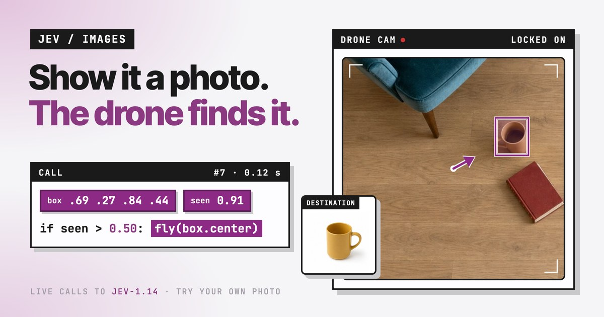

# jev drone cam

[](LICENSE)

Show it a photo and a drone finds it in the room. Every frame is a live call to
[jev](https://typesafe.ai), and plain code flies to the box jev draws.

**Live demo:** https://jev-dronecam-bq3fs.sprites.app



## How it works

1. The drone sweeps a top-down photo of a room, one square camera frame at a time.
2. Each frame goes to jev with the destination photo and two questions:
   - `where` (Box): where is the destination in the drone cam?
   - `seen` (yes/no): is the destination visible in the drone cam at all?
3. If `seen > 0.50`, the drone flies to the center of the box and asks again until it is on top
   of the target. If not, it moves to the next stop in the sweep.

That is the whole control loop:

```python
if seen > 0.50:
    fly(box.center)
else:
    sweep()
```

A slider in the page sets the threshold, so you can watch the drone get pickier or greedier.

## Why gate on `seen`, not box confidence

A Box question always returns a box, even when the object is not in the frame. Its confidence
tells you how sure jev is about *where*, not *whether*. In testing, the empty frame with a rattan
basket scored a higher box confidence than the frame with the real plant (0.46 vs 0.35), and the
drone locked onto the basket.

Asking a yes/no question in the same call fixed it. Over every probe frame:

| | `seen` |
|---|---|
| target in frame | 0.54 to 0.98 |
| target not in frame | 0.13 or lower |

Both questions ride in one request, so the gate costs no extra round trip. A call takes about
0.1 to 0.3 s.

## Try your own

- **+ YOUR PHOTO**: upload any object photo as the destination.
- **NEW ROOM**: upload any top-down photo as the room.
- Tap the destination card to cycle the built-in targets: a mug, a plant, Boots the cat, a book.

Autoplay tours the four built-in targets once and stops, so an idle tab does not keep calling the API.

## Run it locally

You need Python 3.10+ and a TypeSafe API key. There are no dependencies.

```bash
git clone https://github.com/twidtwid/jev-dronecam
cd jev-dronecam
TYPESAFE_API_KEY=your_key python3 server.py
```

Open http://127.0.0.1:9470.

| Variable | Default | |
|---|---|---|
| `TYPESAFE_API_KEY` | (required) | stays on the server; the browser never sees it |
| `DRONECAM_PORT` | `9470` | |
| `DRONECAM_HOST` | `127.0.0.1` | use `0.0.0.0` in a container or VM |
| `DRONECAM_MODEL` | `jev-1.14.0` | |

The server caps calls at 90 a minute. For a public deployment, use a key with a spend limit too.

## Deploy

`deploy/sprite.sh` pushes the app to a [sprites.dev](https://sprites.dev) VM, which sleeps when
nobody is using it. The one-time setup is in the script's header. Any host that can run one
Python process works the same way.

## Project layout

```
server.py           static files + POST /api/box (the only call to jev)
public/index.html   the whole UI: sweep, approach, overlays, minimap, slider
public/img/         the room and the four targets
public/og.jpg       link preview card
og/                 source for the preview card
deploy/sprite.sh    deploy script
```

## The API call

`POST https://api.typesafe.ai/v1/systemone`, with the images inline as base64 assets. Image
input is a preview feature and needs the `TypeSafe-Danger-Zone-Images: true` header.

```json
{
  "model": "jev-1.14.0",
  "state": {"drone cam": "img-1", "destination": "img-2"},
  "assets": {
    "img-1": {"type": "image", "format": "jpg", "data_base64": "..."},
    "img-2": {"type": "image", "format": "jpg", "data_base64": "..."}
  },
  "questions": {
    "where": {"type": "box", "instructions": "Where is the object shown in `destination` in `drone cam`?"},
    "seen":  {"type": "noul", "instructions": "Is the specific object shown in `destination` visible in `drone cam`?"}
  }
}
```

## Credits

The look and the idea come from a drone cam demo video by
[Nathan LeClaire](https://x.com/dotpem) showing jev's Box question. This repo makes it a
working app. The room and target images were generated with gpt-image-2. The targets were
edited from the room image, so they are the same objects.

## License

[MIT](LICENSE)
